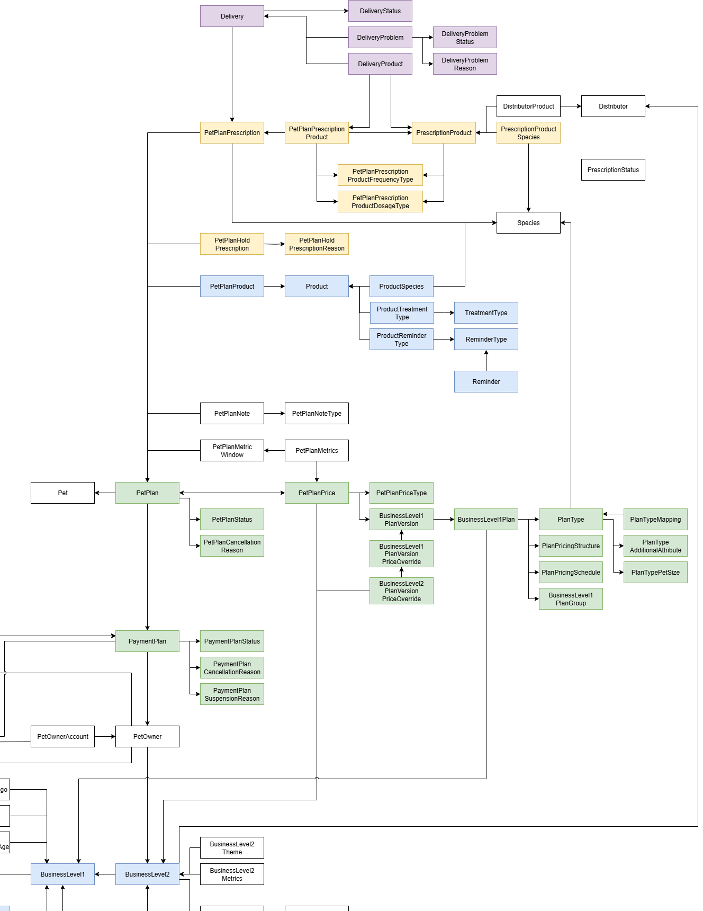

# Home Delivery Stock Issue

## Problem Statement
One of the pain points for the Home Delivery Team at Premier Vet Alliance Ltd., who dealt with pet medication orders, was updating the order rejections as fed back by the distributor. The first step to this two-stage process included updating the order status to ‘Delayed’ on ‘Dispatch’ tab of the portal. This would result in the creation a delivery problem identity. The delivery rejection comment would then be fed back on the ‘Action Needed’ tab, available for the veterinary practitioners to resolve.

Depending on the rejection volume, this laborious task could sometimes take up to two hours a day to feedback the discrepancy reasons. Upon investigation, it was uncovered that more than 68% of the order rejections were due to distributor stock issue. In addition to impacting the operational performance, the volume of rejected orders would cause dissatisfaction among the veterinary practitioners, who would have to regenerate prescriptions with alternative medication.

To avoid losing veterinary practitioner’s faith in Home Delivery as a service and to streamline the discrepancy feedback process for the Home Delivery team, two solutions were engineered:
1. Discrepancy Feedback Tool: a semi-automated process, employing Microsoft Excel Power Query and Postman API Platform, to assist the Home Delivery team in processing high rejection volumes in a fraction of the time
2. Product Forecast Report: an automated report forecasting order volumes at a SKU level, generated using Power BI Paginated Report, to improve stock management and availability

## Discrepancy Feedback Tool
### Data Overview

## Product Forecast Report
A paginated report estimating future order volumes sent to the distributors monthly to manage stock availability and reduce stock related issues.

### Data Overview
This project utilises data collected and stored by Premier Vet Alliance Ltd. in multiple lookup and transactional tables on Microsoft SQL Server. The lookup tables storing the customer, client, and distributor product data ranged from a few thousand to over a hundred thousand entries. Whereas the transactional tables, holding the delivery order and prescription details, held over a million records.

The Entity Relationship Diagram has been attached below to provide an understand of the relationship between the tables utilised in this project.



### Data Preparation
A SQL query was written to drive the paginated report, estimating the expected product volumes based on the currently approved prescriptions. One of the biggest challenges faced during this project was accuartely reporting the future product quantities for every distributor. A veterinary practice can be associated with two distributors, and when one or more prescribed medications are not stocked by their primary distributor, the delivery would be automatically rerouted to the secondary distributor. 
### SQL Code
```
USE[pva_petcareplan_prod_uk];

SELECT *
FROM (
SELECT *
	,SUM(OrderCount) OVER (
		PARTITION BY DistributorProductSKU
		ORDER BY EstimatedProcessingMonth
		ROWS BETWEEN CURRENT ROW AND 2 FOLLOWING) OrderCount_RollingQuarter
	,SUM(ProductQuantity_Monthly) OVER (
		PARTITION BY DistributorProductSKU
		ORDER BY EstimatedProcessingMonth
		ROWS BETWEEN CURRENT ROW AND 2 FOLLOWING) ProductQuantity_RollingQuarter
FROM (
	SELECT EstimatedProcessingMonth
		,ProcessingMonth
		,DistributorName 
		,ProductName
		,DistributorProductName
		,DistributorProductSKU
		,COUNT(DeliveryId) AS OrderCount
		,SUM(ProductQuantity) AS ProductQuantity_Monthly
		
	FROM (
		SELECT dist.[Name] AS PrimaryDistributorName
			,Dist2.[Name] AS SecondaryDistributorName
			,del.id AS DeliveryId
			,del.EstimatedDeliveryDate AS EstimatedDeliveryDate
			,DATETRUNC(MONTH,(DATEADD(DAY, - 16, del.EstimatedDeliveryDate))) AS EstimatedProcessingMonth -- To get Start date for the 'estimated' processing month.
			,FORMAT(DATETRUNC(MONTH,(DATEADD(DAY, - 16, del.EstimatedDeliveryDate))), 'MMMM yyyy') AS ProcessingMonth
			,prep.Name AS ProductName

-- An order can have multiple prescribed product and hence multiple rows with the same delivery id.
-- If one or more products are unavailable with the primary distributor, ALL product lines are rerouted to the secondary distributor even if they can fulfil part of the order.
-- The following CASE statements update the order details based on product unavailability, using a window function.

			,CASE WHEN SUM(CASE WHEN distp.DistributorProductSku IS NULL  OR  distp.DistributorProductSku = '' THEN 1 ELSE 0 END) OVER (PARTITION BY del.id) > 0 
				THEN dist2.Name
				ELSE dist.Name
				END AS DistributorName
			,CASE WHEN SUM(CASE WHEN distp.DistributorProductSku IS NULL OR  distp.DistributorProductSku = ''  THEN 1 ELSE 0 END) OVER (PARTITION BY del.id) > 0 
				THEN distp2.DistributorProductSku
				ELSE distp.DistributorProductSku
				END AS DistributorProductSKU
			,CASE WHEN SUM(CASE WHEN distp.DistributorProductSku IS NULL OR  distp.DistributorProductSku = '' THEN 1 ELSE 0 END) OVER (PARTITION BY del.id) > 0 
				THEN  distp2.DistributorProductName
				ELSE  distp.DistributorProductName
				END AS DistributorProductName
			-- The following CASE statement calculates the product quantity that will be sent to the distributor with each order.
			,CASE 
				WHEN pppp.AdministrationFrequency = 1
				AND pppp.AdministrationFrequencyTypeRef = 3
				THEN CEILING(pppp.Dose) * 3
				WHEN pppp.AdministrationFrequency IN (3,6)
				AND pppp.AdministrationFrequencyTypeRef = 3 
				THEN CEILING(pppp.Dose)
				WHEN pppp.AdministrationFrequency IN (28,29,30,31)
				AND pppp.AdministrationFrequencyTypeRef = 1
				THEN CEILING(pppp.Dose)
				WHEN pppp.AdministrationFrequency IN (4,5,12)
				AND pppp.AdministrationFrequencyTypeRef = 2
				THEN CEILING(pppp.Dose)
				ELSE CEILING(pppp.Dose)
				END AS ProductQuantity
		FROM Delivery del
		INNER JOIN PetPlanPrescription ppp ON del.PetPlanPrescriptionRef = ppp.Id
		INNER JOIN PetPlan pp ON ppp.PetPlanRef = pp.Id
		INNER JOIN PaymentPlan payp ON pp.PaymentPlanRef = payp.Id
		INNER JOIN PetOwner po ON payp.PetOwnerRef = po.Id
		INNER JOIN BusinessLevel2 bl2 ON po.BusinessLevel2Ref = bl2.Id
		INNER JOIN Distributor dist ON bl2.DistributorRef = dist.Id
		LEFT JOIN Distributor dist2 ON dist2.Id = BL2.SecondaryDistributorRef -- LEFT JOIN is used as not all practices have a secondary distributor so need to keep the NULLs.  
		INNER JOIN DeliveryProduct delp ON delp.DeliveryRef = del.Id
		INNER JOIN PetPlanPrescriptionProduct pppp ON pppp.PetPlanPrescriptionRef = ppp.Id 
			AND pppp.Id = delp.PetPlanPrescriptionProductRef
		INNER JOIN PrescriptionProduct prep ON prep.Id = pppp.PrescriptionProductRef 
			AND prep.Id = delp.PrescriptionProductRef 
		LEFT JOIN DistributorProduct distp ON distp.DistributorRef = dist.Id -- LEFT JOIN is used as the primary distributor may not have one or more prescribed products so need to keep the NULLs.
			AND distp.PrescriptionProductRef = prep.Id
		LEFT JOIN DistributorProduct distp2 ON distp2.DistributorRef = dist2.Id -- LEFT JOIN is used as the secondary distributor may also not have the same prescribed products so need to keep the NULLs.
			AND distp2.PrescriptionProductRef = prep.Id
		WHERE del.DeliveryStatusRef = 7 -- Delivery Status 'Not Due'.
			AND DATETRUNC(MONTH,(DATEADD(DAY, - 16, del.EstimatedDeliveryDate))) >= GetDate()
			AND (
				Distp.Enabled = 1
				OR distp2.Enabled = 1
				) 
		) AS OrderSplit
	GROUP BY 
		EstimatedProcessingMonth
		,ProcessingMonth
		,DistributorName
		,ProductName
		,DistributorProductName
		,DistributorProductSKU
) AS OrderQuantity
) AS ParameterIssue
WHERE DistributorName IN (@DistributorName)
	AND ProcessingMonth IN (@ProcessingMonth)
```

## Results
1. The Discrepancy Feedback tool has helped the Home Delivery team reduce processing time to under 15 minutes, saving 1-2 hours daily
2. Just within the first month of deploying the Product Forecast Report, stock related order rejections reduced by 20%
3. Customer service Home Delivery refund tickets raised by veterinary practices reduced by 8%
4. Saved the business at least £10,000 in medication refunds and labour costs

